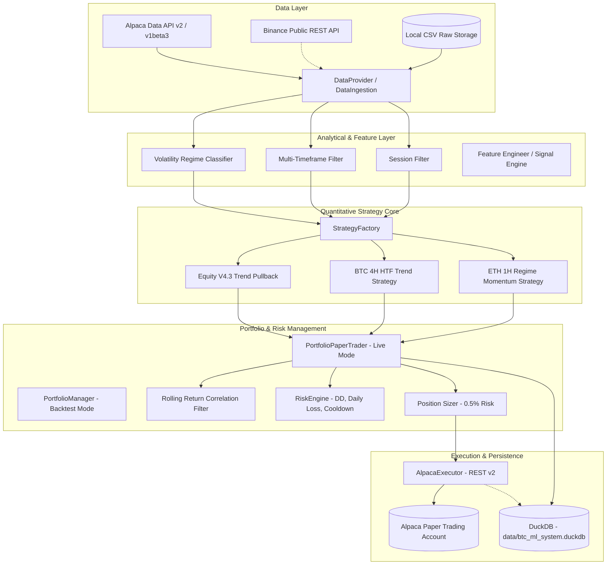
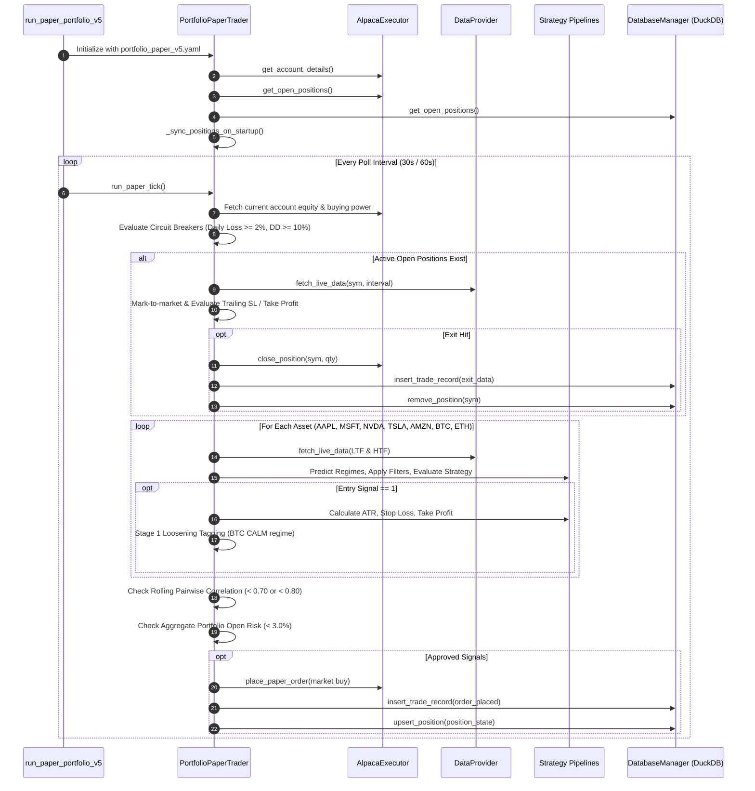

# BTC-ML SYSTEM V2 — ARCHITECTURE MAP
**Phase 0: Technical Architecture Reconstruction & Component Topology**  
**Date:** November 18, 2026  
**Auditors:** Senior Python Software Architect, Principal Quantitative Developer  

---

## 1. System Architecture Overview

The **btc-ml-system** repository contains two distinct architectural generations:
1. **The Machine Learning Research Pipeline (V1 / V2):** An offline research stack developed for cryptocurrency triple-barrier labeling, feature engineering, ensemble modeling (LightGBM, XGBoost, Logistic Regression, Stacking), probability calibration, and continuous bet sizing.
2. **The Multi-Asset Quantitative Trading System (V3 - V5):** A production-oriented quantitative framework featuring rule-based regime filters, multi-timeframe moving averages, momentum breakouts, pairwise cross-asset correlation control, portfolio-level risk budgets, and live Alpaca REST execution.

---

## 2. High-Level Component Topology

---

## 3. End-to-End Execution Flow (Live Paper Trading)

The primary live production runner is `run_paper_portfolio_v5.py`, invoking `PortfolioPaperTrader.run_paper_tick()` on an event loop:

---

## 4. Architectural Analysis & Findings

### Finding ARC-001: Disconnected Prototype Package (`crypto_ml_trader`)
- **Severity:** Medium
- **Exact File Path:** `BTC_ML_System/crypto_ml_trader/`
- **Function or Class:** Entire directory tree
- **Existing Behavior:** The directory `crypto_ml_trader/` contains a duplicate implementation of the entire ML and backtesting pipeline (features, labels, models, regimes, risk, splits), complete with its own isolated virtual environment (`venv/`). It is never referenced or imported by `btc_ml_system`.
- **Expected Behavior:** Research prototypes should either be maintained as modular sub-packages within the primary library, archived in a designated `archive/` or `research/` directory, or integrated cleanly into unified test suites.
- **Identified Gap:** Creates severe cognitive overhead, redundancy, and developer confusion regarding which modules are authoritative.
- **Recommended Fix:** Safely archive `crypto_ml_trader/` into `archive/crypto_ml_trader_v2/` after verifying no unique research weights or data are lost.
- **Required Test:** Run `pytest BTC_ML_System/btc_ml_system/tests` to guarantee zero dependency breakage.

---

### Finding ARC-002: Redundant Legacy Paper Trader Module
- **Severity:** Low
- **Exact File Path:** `BTC_ML_System/btc_ml_system/src/paper_trader.py`
- **Function or Class:** `PaperTrader`
- **Existing Behavior:** `paper_trader.py` contains a single-asset mock runner that queries Binance klines and runs `LiveInferencePipeline`. It does not interface with Alpaca, does not use DuckDB, and is superseded by `portfolio_paper_trader.py`.
- **Expected Behavior:** Single-asset paper trading should use the unified `DataProvider` and `AlpacaExecutor` architecture, or be clearly marked as deprecated.
- **Identified Gap:** Two files named `paper_trader.py` and `portfolio_paper_trader.py` exist in the same source directory, creating ambiguity.
- **Recommended Fix:** Deprecate `paper_trader.py` with explicit module-level warnings or refactor it into a single-asset adapter of `PortfolioPaperTrader`.
- **Required Test:** Inspect runner scripts to ensure no active V5 scripts invoke legacy `PaperTrader`.

---

### Finding ARC-003: Disjoint Machine Learning Pipeline from V5 Live Execution
- **Severity:** Medium
- **Exact File Path:** `BTC_ML_System/btc_ml_system/src/models.py`, `features.py`, `labels.py`, `meta_labeler.py`
- **Function or Class:** `EnsembledModel`, `FeatureEngineer`, `TripleBarrierLabeler`, `MetaLabeler`
- **Existing Behavior:** The machine learning components (trained models in `models/lightgbm_model.joblib`, `models/calibrator.joblib`) are completely bypassed during V4/V5 strategy evaluation. Signals are generated exclusively via deterministic rules (RSI, EMA, Donchian, Bollinger Bandwidth).
- **Expected Behavior:** Either the system is explicitly documented as a hybrid rule-based + ML platform where ML acts as a meta-labeling filter, or the ML layer is integrated into the `StrategyFactory` / `SignalEngine` pipeline.
- **Identified Gap:** The repository name is `BTC_ML_System`, but active production paper trading operates 100% on heuristic technical strategies without ML inference.
- **Recommended Fix:** In Phase 3, connect `MetaLabeler` as an optional secondary stage filter inside `SignalEngine.generate_signal()`, allowing ML probability thresholds to gate or scale positions.
- **Required Test:** Add unit tests validating that `MetaLabeler` can score live incoming feature vectors from `DataProvider`.
