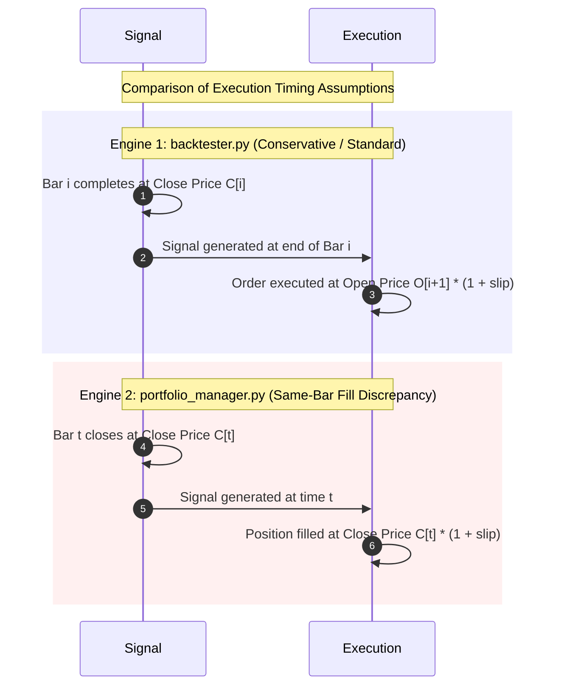

# BTC-ML SYSTEM V2 — BACKTESTING & SIMULATION AUDIT
**Phase 0: Simulation Engines, Execution Assumptions, Biases & Cost Models**  
**Date:** November 18, 2026  
**Auditors:** Principal Quantitative Developer, Quantitative Researcher  

---

## 1. Backtesting Engine Comparison

The repository houses two distinct simulation backtesters:

| Feature | Single-Asset Engine (`backtester.py`) | Multi-Asset Portfolio Engine (`portfolio_manager.py`) |
| :--- | :--- | :--- |
| **Asset Universe** | Single symbol (`BTCUSDT` or `AAPL`) | Full portfolio (5 Stocks + BTC + ETH) |
| **Timeline Model** | Sequential integer iteration `range(len(df)-1)` | Synchronized unified hourly UTC time grid |
| **Execution Timing** | **Next-Bar Open** (`open[i+1]`) | **Same-Bar Close** (`close[t]`) |
| **Slippage Model** | Fixed basis points (`slippage_bps / 10000`) | Fixed basis points applied to entry and exit |
| **Commission Model**| Fixed basis points (`commission_bps / 10000`) | Fixed basis points deducted from return |
| **Trailing Stop** | Dynamic trailing stop with trigger and dist | Dynamic trailing stop + profit runner support |
| **Persistence** | In-memory trade objects + `TradeJournal` | Trade dictionaries + `equity_curve` timeseries |
| **Cross-Asset Rules**| None | Rolling correlation matrix + portfolio risk limits |

---

## 2. Execution Timing & Pricing Analysis



---

## 3. Backtesting Audit Findings

### Finding BKT-001: Execution Timing Discrepancy (Next-Bar Open vs Same-Bar Close)
- **Severity:** HIGH
- **Exact File Path:** `BTC_ML_System/btc_ml_system/src/backtester.py` vs `portfolio_manager.py`
- **Function or Class:** `Backtester.run_backtest` (lines 128-133, 265) vs `PortfolioManager.run_portfolio_backtest` (lines 307, 354-358)
- **Existing Behavior:**
  - `backtester.py`: Evaluates signals at bar `i` and fills the order on the **next bar open** (`curr_open = open_prices[i + 1]`, `entry_price = curr_open * (1.0 + slip)`).
  - `portfolio_manager.py`: Evaluates signals at timestamp `t` and fills the order at the **close price of the exact same bar** (`entry_price = float(row["close"])`, entered at time `t`).
- **Expected Behavior:** Both backtest engines must use consistent, realistic execution mechanics matching live market feasibility. A trader cannot observe the close of a candle at `t` and simultaneously buy at that exact close price without latency.
- **Identified Gap:** Same-bar close execution introduces artificial performance inflation in momentum and breakout strategies, where the next bar often opens with an adverse gap.
- **Recommended Fix:** Standardize `PortfolioManager` to execute on the **next bar open** (`t + 1 bar`), harmonizing it with `backtester.py`.
- **Required Test:** Run comparative backtest on `AAPL` comparing same-bar close vs next-bar open fills to quantify return drag.

---

### Finding BKT-002: Gap Slippage Omission on Stop-Loss Exits
- **Severity:** MEDIUM
- **Exact File Path:** `BTC_ML_System/btc_ml_system/src/portfolio_manager.py` and `backtester.py`
- **Function or Class:** `PortfolioManager.run_portfolio_backtest` (lines 212-221) and `Backtester.run_backtest` (lines 169-179)
- **Existing Behavior:** When a stop-loss is triggered (`curr_low <= sl_price`), both engines assign the exit price as exactly `sl_price`:
  `exit_price = pos["sl_price"]`
- **Expected Behavior:** In real market conditions, if an asset gaps open below the stop price (e.g. overnight earnings announcements for stocks or weekend flash crashes for crypto), the fill price is capped at the bar's `open` price:
  `exit_price = min(pos["sl_price"], curr_open)`
- **Identified Gap:** The backtester understates catastrophic gap risk by assuming stop orders are always guaranteed at the exact stop-loss price, even during major market gaps.
- **Recommended Fix:** Add opening gap slippage handling:
  ```python
  if curr_open < pos["sl_price"]:
      exit_price = curr_open  # Gapped below stop price
  else:
      exit_price = pos["sl_price"]
  ```
- **Required Test:** Create a synthetic candle that gaps down 5% below the stop price and verify the trade exits at the gapped open price.

---

### Finding BKT-003: Survivorship & Universe Selection Bias
- **Severity:** LOW
- **Exact File Path:** `BTC_ML_System/btc_ml_system/configs/portfolio_v5.yaml`
- **Function or Class:** Universe configuration `symbols`
- **Existing Behavior:** The equity basket consists of five mega-cap tech stocks: `AAPL`, `MSFT`, `NVDA`, `TSLA`, `AMZN`.
- **Expected Behavior:** Long-term backtests of a fixed basket of historical mega-cap winners incur survivorship and selection bias.
- **Identified Gap:** The strategy backtests on assets selected with hindsight of their exceptional performance over the 2020-2026 bull cycle.
- **Recommended Fix:** Document selection bias transparently in research reports, and add a dynamic or neutral universe (e.g. equal-weighted S&P 500 top 50 by market cap point-in-time) in future research phases.
- **Required Test:** Document historical drawdown characteristics under market downturns (e.g. 2022 tech bear market).
