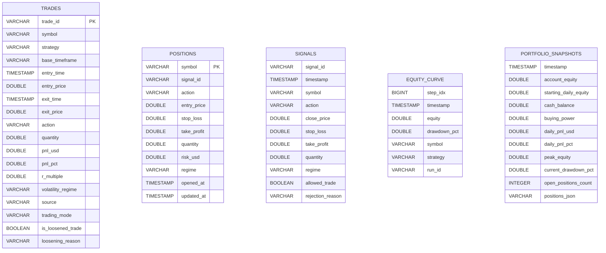

# BTC-ML SYSTEM V2 — DATABASE AUDIT
**Phase 0: DuckDB Analytical Storage, Schema Integrity, Migrations & ACID Compliance**  
**Date:** November 18, 2026  
**Auditors:** Senior Python Software Architect, Principal Quantitative Developer  

---

## 1. Database Architecture Overview

The system utilizes **DuckDB** as its embedded analytical database engine (`data/btc_ml_system.duckdb`). DuckDB provides columnar, vectorized analytical query capabilities, zero-dependency deployment, and ACID transaction guarantees.

---

## 2. Forensic Table Inventory & Record Counts

A live inspection of `data/btc_ml_system.duckdb` confirms the following record state:

| Table Name | Record Count | Primary Purpose | Existing Sources Present |
| :--- | :---: | :--- | :--- |
| `trades` | **1,334** | Historical backtests & paper trading journal | `migrated` (696 rows), `backtest` (638 rows) |
| `positions` | **0** | Active open live broker positions | Clean (0 active positions) |
| `signals` | **0** | Candidate signal generation audit log | Clean (Awaiting Phase 1 live orders) |
| `equity_curve` | **47,100** | Point-in-time equity and drawdown history | Multi-asset backtest runs |
| `portfolio_snapshots` | **48** | Daily account health & equity baselines | Daily summary logs |

---

## 3. Database Audit Findings

### Finding DB-001: Deprecated `datetime.datetime.utcnow()` Usage
- **Severity:** LOW
- **Exact File Path:** `BTC_ML_System/btc_ml_system/src/database.py` (lines 396, 463)
- **Function or Class:** `DatabaseManager.upsert_position` and `insert_portfolio_snapshot`
- **Existing Behavior:** The database manager invokes `datetime.datetime.utcnow()` to supply fallback timestamps.
- **Expected Behavior:** In Python 3.12+, `datetime.datetime.utcnow()` is deprecated and scheduled for future removal. Code should utilize timezone-aware UTC timestamps: `datetime.datetime.now(datetime.timezone.utc)`.
- **Identified Gap:** Generates `DeprecationWarning` logs during database writes.
- **Recommended Fix:** Replace all occurrences of `datetime.datetime.utcnow()` with `datetime.datetime.now(datetime.timezone.utc)`.
- **Required Test:** Run `pytest BTC_ML_System/btc_ml_system/tests/test_database.py` and verify zero deprecation warnings.

---

### Finding DB-002: File Lock Contention in Multi-Process Access
- **Severity:** MEDIUM
- **Exact File Path:** `BTC_ML_System/btc_ml_system/src/database.py`
- **Function or Class:** `DatabaseManager.get_connection`
- **Existing Behavior:** `get_connection()` creates a standard direct connection: `duckdb.connect(str(self.db_path))`.
- **Expected Behavior:** DuckDB allows multiple read-only connections or a single read-write connection. If a secondary script (e.g. an analytical Jupyter notebook or CLI dashboard) attempts to connect with read-write access while `run_paper_portfolio_v5.py` is actively writing, DuckDB raises an `IOException: Could not set lock on file`.
- **Identified Gap:** Potential operational crash if an operator inspects the live database while the paper trading daemon is running.
- **Recommended Fix:** Provide a `read_only=True` parameter in `get_connection()` for inspection scripts, and implement retry backoff with exponential jitter for concurrent write requests.
- **Required Test:** Simulate simultaneous connections from two processes and assert graceful retry or read-only fallback.

---

### Finding DB-003: Double Logging of Open Orders in `trades` Table
- **Severity:** MEDIUM
- **Exact File Path:** `BTC_ML_System/btc_ml_system/src/portfolio_paper_trader.py` (lines 325-350, 543-570)
- **Function or Class:** `PortfolioPaperTrader._log_trade_journal`
- **Existing Behavior:** When a paper order is placed, `_log_trade_journal()` inserts a record into the `trades` table with `exit_reason = "OPEN_PAPER_POSITION"`, `exit_price = entry_price`, and `pnl_usd = 0.0`. When the position is subsequently closed, a *second* record is inserted with `exit_reason = "PT_HIT"` or `"SL_HIT"` and the realized PnL.
- **Expected Behavior:** The `trades` table should represent realized completed trades, or use a distinct `status` column (`OPEN` vs `CLOSED`) to prevent double-counting total trade counts in analytical aggregations.
- **Identified Gap:** Queries such as `SELECT COUNT(*) FROM trades` will count a single round-trip trade twice (once at open and once at close), skewing win rate and trade frequency analytics.
- **Recommended Fix:** Add a `status` column (`OPEN` / `CLOSED`) to the `trades` table schema and update the existing open record upon trade closure via `trade_id`, rather than inserting a duplicate row.
- **Required Test:** Execute a full open-to-close trade cycle and verify that exactly one row exists in `trades` with status `CLOSED`.
