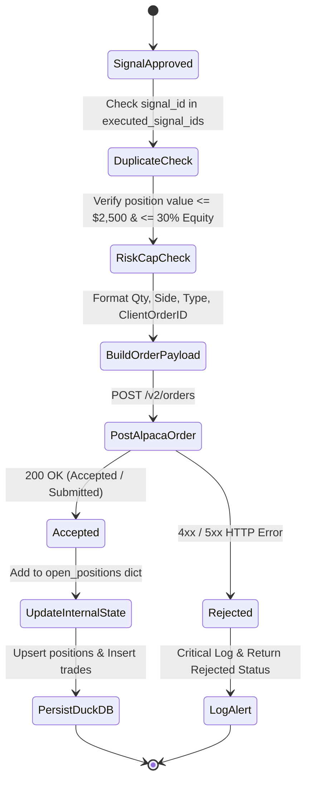

# BTC-ML SYSTEM V2 — EXECUTION ENGINE AUDIT
**Phase 0: Alpaca REST API Execution, Order Life Cycle, Reconciliation & Resilience**  
**Date:** November 18, 2026  
**Auditors:** Site Reliability Engineer, Senior Algorithmic Trading Engineer  

---

## 1. Execution Architecture Overview

Execution is orchestrated by `AlpacaExecutor` interacting directly with the Alpaca Paper Trading REST API v2 (`https://paper-api.alpaca.markets/v2`).



---

## 2. Order Submission & Life Cycle Audit

### 2.1 API Endpoints Utilized
- `GET /v2/account`: Account equity, cash balance, and buying power.
- `GET /v2/positions`: Active open broker positions.
- `POST /v2/orders`: Order submission.
- `DELETE /v2/positions/{symbol}`: Individual position closure.
- `DELETE /v2/positions`: Close/flatten all open broker positions.
- `DELETE /v2/orders`: Cancel all open/pending orders.

### 2.2 Position Reconciliation on Startup
`PortfolioPaperTrader._sync_positions_on_startup()` queries Alpaca `GET /v2/positions` and DuckDB `positions` table:
1. Active positions on Alpaca are loaded into internal state `open_positions`.
2. Missing or closed positions are cleaned out of DuckDB.
3. Symbol name normalization handles the Alpaca `/` difference cleanly (`clean_sym = raw_sym.replace("/", "")`).

---

## 3. Execution Forensic Findings

### Finding EXE-001: Illegal Characters in `client_order_id` (Spaces & Colons)
- **Severity:** HIGH
- **Exact File Path:** `BTC_ML_System/btc_ml_system/src/alpaca_executor.py` (line 260) and `portfolio_paper_trader.py` (line 413)
- **Function or Class:** `AlpacaExecutor.place_paper_order`
- **Existing Behavior:** The `client_order_id` is constructed as:
  `client_order_id = f"v5_{signal_id[:20]}"`
  In `portfolio_paper_trader.py:413`, `signal_id` is defined as:
  `sig_id = f"{sym}_{latest_bar['open_time']}"`
  For a candle timestamp `2026-11-18 16:00:00+00:00`, `client_order_id` becomes:
  `"v5_BTCUSDT_2026-11-18 1"`
- **Expected Behavior:** Alpaca's API specification strictly mandates that `client_order_id` must consist exclusively of alphanumeric characters, hyphens, and underscores: `^[a-zA-Z0-9_-]+$`.
- **Identified Gap:** The inclusion of whitespace (` `) and colons (`:`) causes Alpaca to reject order submissions with an **HTTP 422 Unprocessable Entity** error, preventing paper orders from being placed.
- **Recommended Fix:** Sanitize `client_order_id` by stripping spaces, colons, and special characters:
  ```python
  clean_sig = re.sub(r"[^a-zA-Z0-9_-]", "_", signal_id)
  payload["client_order_id"] = f"v5_{clean_sig[:40]}"
  ```
- **Required Test:** Unit test submitting a mock order with whitespace and colons in `signal_id`, asserting the sanitized string matches `^[a-zA-Z0-9_-]+$`.

---

### Finding EXE-002: Lack of Order Polling and Fill Price Verification
- **Severity:** HIGH
- **Exact File Path:** `BTC_ML_System/btc_ml_system/src/alpaca_executor.py`
- **Function or Class:** `AlpacaExecutor.place_paper_order` (lines 263-268)
- **Existing Behavior:** When Alpaca returns `status: 200 OK` (order accepted or submitted), `AlpacaExecutor` immediately treats the order as filled:
  `if order_res.get("status") in ["accepted", "submitted", "filled", "dry_run_success"]:`
  It records the trade in DuckDB using the pre-trade estimated candle close price (`close_price`) instead of the actual executed fill price.
- **Expected Behavior:** Market orders should be verified:
  1. Poll `GET /v2/orders/{id}` or listen via Alpaca Trade Updates WebSocket until status transitions to `filled`.
  2. Retrieve `filled_avg_price` and `filled_qty`.
  3. Detect and handle partial fills (`partially_filled`).
- **Identified Gap:** If an order remains pending or is rejected asynchronously by the exchange matching engine, the system still registers the trade as an active filled position in DuckDB and memory, leading to state desynchronization between the bot and the broker.
- **Recommended Fix:** Implement a short synchronous polling loop (up to 3 seconds with 500ms sleep) polling `GET /v2/orders/{id}` to verify `filled` status and record exact fill prices.
- **Required Test:** Mock order lifecycle transitioning from `new` -> `partially_filled` -> `filled`, asserting proper state and price capture.

---

### Finding EXE-003: Fractional Equity Orders Rejecting on GTC Time-In-Force
- **Severity:** MEDIUM
- **Exact File Path:** `BTC_ML_System/btc_ml_system/src/alpaca_executor.py` (lines 200, 251-259)
- **Function or Class:** `AlpacaExecutor.place_paper_order`
- **Existing Behavior:** The default argument is `time_in_force: str = "gtc"`. If an equity order has a fractional quantity (e.g. `qty = 0.45` shares of NVDA or TSLA), it sends `time_in_force="gtc"`.
- **Expected Behavior:** Alpaca's trading API strictly enforces that **fractional orders for US equities must have `time_in_force="day"`**.
- **Identified Gap:** Any fractional stock order submitted with `gtc` is rejected by Alpaca with the error: `"fractional orders must have time_in_force day"`.
- **Recommended Fix:** In `place_paper_order`, automatically override `time_in_force = "day"` whenever `is_equity and (qty % 1 != 0 or qty < 1.0)`.
- **Required Test:** Test placing order for 0.5 shares of AAPL with default arguments, verifying `time_in_force` is automatically switched to `"day"`.

---

### Finding EXE-004: In-Memory `executed_signal_ids` Loss on Process Restart
- **Severity:** MEDIUM
- **Exact File Path:** `BTC_ML_System/btc_ml_system/src/alpaca_executor.py` (lines 47, 210, 226)
- **Function or Class:** `AlpacaExecutor.__init__` and `place_paper_order`
- **Existing Behavior:** `self.executed_signal_ids = set()` is stored strictly in volatile RAM.
- **Expected Behavior:** `executed_signal_ids` should be persisted in DuckDB to maintain idempotency across process restarts.
- **Identified Gap:** If the process is stopped and restarted during an active bar, previously executed signals during that bar will be re-executed if signal conditions are still met, placing accidental duplicate orders.
- **Recommended Fix:** On startup, populate `executed_signal_ids` from DuckDB:
  `SELECT DISTINCT signal_id FROM signals WHERE signal_id IS NOT NULL`
- **Required Test:** Insert a signal ID into DuckDB, instantiate `AlpacaExecutor`, and verify the ID is recognized as already executed.
