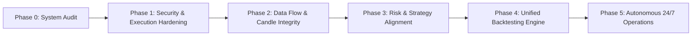

# BTC-ML SYSTEM V2 — IMPLEMENTATION ROADMAP
**Phase 0 to Phase 5 Engineering & Quantitative Evolution Plan**  
**Date:** November 18, 2026  
**Auditors:** Principal Quantitative Developer, Senior Algorithmic Trading Engineer, Site Reliability Engineer  

---

## 1. Engineering Evolution Strategy

To transition **btc-ml-system** from its current prototype state into an institutional-grade quantitative research and autonomous paper-trading platform, we define a structured, 5-phase engineering roadmap.

**STRICT GOVERNANCE RULE:**  
No Phase 1 work may begin without explicit user review and approval of the Phase 0 audit findings.

---

## 2. Phased Implementation Breakdown

### Phase 1: Security Hardening & Execution Reliability (Priority: IMMEDIATE)
**Objective:** Eliminate critical secrets exposure, fix order rejection vulnerabilities, and introduce robust mock testing.
1. **Secrets Sanitization (`SEC-001`):**
   - Strip all hardcoded API keys and secrets from `alpaca_executor.py` and `data_provider.py`.
   - Replace plaintext keys in `portfolio_paper_v5.yaml` with environment variable interpolation.
   - Create `.env.example` and integrate `python-dotenv`.
   - Update `.gitignore` to exclude `.env`, `.env.*`, and `*.duckdb` (`SEC-002`).
   - Untrack `data/btc_ml_system.duckdb` from git while preserving local database.
2. **Order Execution Hardening (`EXE-001`, `EXE-003`):**
   - Sanitize `client_order_id` in `alpaca_executor.py` by removing spaces and colons to comply with Alpaca regex `^[a-zA-Z0-9_-]+$`.
   - Automatically switch `time_in_force = "day"` for fractional stock orders to prevent Alpaca 422 rejections.
   - Add hard live-money mutual exclusion assertion in `AlpacaExecutor` (`SEC-003`).
3. **Execution State Polling (`EXE-002`):**
   - Implement short synchronous polling loop in `AlpacaExecutor` to verify order status transitions to `filled` and capture exact execution prices.
4. **Mock Integration Testing Suite (`TST-001`):**
   - Build `tests/test_alpaca_executor.py` utilizing `requests_mock` covering order placement, duplicate rejections, and kill switches.

---

### Phase 2: Market Data Integrity & Real-Time Alignment (Priority: HIGH)
**Objective:** Guarantee that live paper trading evaluates closed, non-flickering candles matching backtested conditions.
1. **Candle Completion Guard (`DAT-001`):**
   - Modify `PortfolioPaperTrader.run_paper_tick()` to evaluate strategy signals exclusively on finalized, closed bars (`df.iloc[-2]` or timestamp boundary verification `now_utc >= candle_close_time`).
2. **Automated Lookback Gap Backfilling (`DAT-002`):**
   - Enhance `DataProvider` to detect gaps between cached historical data and live feeds, automatically paginating backwards via Alpaca REST API to eliminate multi-week lookback discontinuities.
3. **Cache Validation & Expiration (`DAT-003`):**
   - Add end-date verification in `DataProvider.fetch_data()` so backtests never execute on stale, outdated CSV snapshots.
4. **Calendar-Aware Data Quality Checks (`DAT-004`):**
   - Update `DataQualityChecker` to differentiate continuous 24/7 crypto markets from NYSE/NASDAQ session hours for equities.

---

### Phase 3: Risk & Strategy Calibration Alignment (Priority: MEDIUM)
**Objective:** Standardize risk sizing denominators, synchronize configuration files, and re-couple ML meta-labeling.
1. **Risk Denominator Architecture (`RSK-001`):**
   - Implement configurable risk denominator in `portfolio_paper_v5.yaml`:
     - Option A: Total Portfolio Equity (Standard institutional model: 0.5% of total portfolio equity per trade).
     - Option B: Component Allocation Sub-Capital (Existing hierarchical model: 0.5% of sub-strategy weight).
2. **Configuration Synchronization (`STR-001`, `RSK-002`):**
   - Update `eth_1h_v4.5.yaml` to set `session_filter: enabled: false`, eliminating discrepancies between standalone backtests and portfolio paper trading.
   - Reconcile component config daily loss limits (1.0%) with portfolio master limit (2.0%).
3. **Volatility Annualization Scaling (`STR-002`):**
   - Update `VolatilityRegimeClassifier` to scale standard deviations by exact frequency factors (`sqrt(2190)` for 4H crypto, `sqrt(1638)` for 1H stocks).
4. **Machine Learning Meta-Labeler Integration (`ARC-003`, `DEP-001`):**
   - Consolidate duplicate `MetaLabeler` implementations into a single `meta_labeling.py` module.
   - Wire `MetaLabeler.predict_meta_prob()` into `SignalEngine` as an optional secondary probability filter.

---

### Phase 4: Unified Backtesting & Portfolio Simulation (Priority: MEDIUM)
**Objective:** Establish 100% mathematical and execution parity between backtesting and live paper trading.
1. **Execution Timing Standardization (`BKT-001`):**
   - Align `PortfolioManager` to execute entries on next-bar open (`open[t+1]`), harmonizing it with `backtester.py` and eliminating same-bar close execution bias.
2. **Opening Gap Slippage Modeling (`BKT-002`):**
   - Incorporate opening gap handling for stop-loss orders in both backtesters: `exit_price = min(sl_price, open)`.
3. **Purged Walk-Forward & CPCV Validation:**
   - Integrate `DataSplitter.purged_walk_forward_splits` into `run_pipeline_v5.1.py` for automated walk-forward out-of-sample reporting.

---

### Phase 5: Autonomous 24/7 Operations & Analytics (Priority: LOW)
**Objective:** Institutional reliability, fault tolerance, monitoring, and live analytics.
1. **Restart Recovery & State Persistence (`RSK-003`, `EXE-004`):**
   - Restore daily high-water mark, start-of-day equity, and executed signal IDs directly from DuckDB upon process initialization.
2. **DuckDB Multi-Process Concurrency (`DB-002`):**
   - Implement read-only connection pooling and write-retry backoff to allow simultaneous CLI dashboards while paper trading runs.
3. **Database Trade De-duplication (`DB-003`):**
   - Update `trades` table schema with a `status` column (`OPEN` / `CLOSED`), updating the existing row upon trade exit rather than creating duplicate open records.
4. **Autonomous Health Heartbeat & Alerts:**
   - Add automated Slack / Discord / Email webhook notifications for circuit breaker triggers, Alpaca order executions, and daily summary reports.

---

## 3. Prioritized Implementation Matrix

| Phase | Finding / Task | Impact | Complexity | Urgency |
| :---: | :--- | :---: | :---: | :---: |
| **Phase 1** | `SEC-001`: Strip hardcoded credentials & integrate `.env` | Critical | Low | Immediate |
| **Phase 1** | `SEC-002`: Update `.gitignore` (`.env`, `*.duckdb`) | High | Low | Immediate |
| **Phase 1** | `EXE-001`: Sanitize `client_order_id` (remove spaces/colons) | High | Low | Immediate |
| **Phase 1** | `EXE-003`: Fix fractional stock order `time_in_force="day"` | High | Low | Immediate |
| **Phase 1** | `EXE-002`: Implement order status fill polling & real fill prices | High | Medium | Immediate |
| **Phase 1** | `TST-001`: Create `test_alpaca_executor.py` with mock REST | High | Medium | High |
| **Phase 2** | `DAT-001`: Evaluate signals on closed candles (prevent flicker) | High | Medium | High |
| **Phase 2** | `DAT-002`: Backfill historical warmup gaps via Alpaca REST | Medium | Medium | High |
| **Phase 3** | `RSK-001`: Clarify & configure risk denominator (Total vs Sub) | High | Low | Medium |
| **Phase 3** | `STR-001`: Synchronize `eth_1h_v4.5.yaml` session filter | Medium | Low | Medium |
| **Phase 4** | `BKT-001`: Harmonize backtester to next-bar open fills | High | Medium | Medium |
| **Phase 5** | `RSK-003` & `EXE-004`: Database state recovery on restart | Medium | Medium | Low |

---

## 4. Phase 0 Completion Statement

The comprehensive Phase 0 quantitative system audit is complete. All 12 audit documents have been generated in `docs/audit/`. 

No production source code or configuration files have been altered during this audit.

**WAIT FOR MY APPROVAL BEFORE PHASE 1.**
