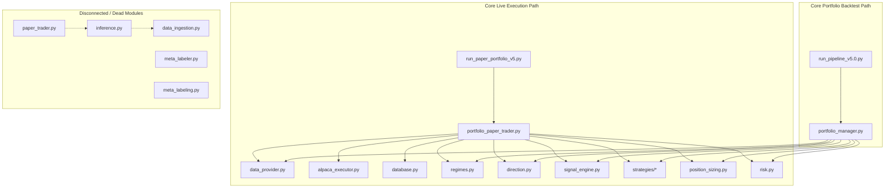

# BTC-ML SYSTEM V2 — MODULE DEPENDENCY MAP
**Phase 0: Module Coupling, Import Graphs, and Dead Code Inventory**  
**Date:** November 18, 2026  
**Auditors:** Senior Python Software Architect  

---

## 1. Source Module Inventory & Classification

The `btc_ml_system/src/` package contains 23 Python source modules and a strategies subpackage (`strategies/`).

| Module | Core Purpose | Active in V5 Paper Trading? | Active in V5 Backtesting? | Active in Tests? | Status |
| :--- | :--- | :---: | :---: | :---: | :--- |
| `alpaca_executor.py` | Alpaca REST API order execution & positions | **YES** | NO | NO (Missing mock tests) | Production |
| `backtester.py` | Single-asset event-driven backtesting engine | NO | NO (V4.x runners) | YES (`test_pipeline.py`) | Maintained |
| `calibration.py` | Probability calibration (Isotonic/Sigmoid) | NO | NO | YES (`test_pipeline.py`) | Maintained (ML) |
| `database.py` | DuckDB analytical database interface | **YES** | **YES** (Via journal) | YES (`test_database.py`) | Production |
| `data_ingestion.py` | Binance REST API, BiQuote, Apify ingestion | NO | NO | YES (`test_pipeline.py`) | Legacy/Auxiliary |
| `data_provider.py` | Unified live/cached data fetcher (Alpaca/CSV) | **YES** | **YES** | NO | Production |
| `data_quality.py` | Data validation, missing candle checks | NO | NO (Called in V4) | YES (`test_pipeline.py`) | Maintained |
| `direction.py` | Breakout logic, SessionFilter, MultiTimeframeFilter | **YES** | **YES** | NO | Production |
| `features.py` | Technical & statistical feature generation | NO | NO | YES (`test_features.py`) | Maintained (ML) |
| `inference.py` | Live inference wrapper for ML models | NO | NO | NO | Dead Code |
| `labels.py` | Triple-barrier labeling & sample weighting | NO | NO | YES (`test_labels.py`) | Maintained (ML) |
| `meta_labeler.py` | V3.4 Logistic/LGBM signal win-probability filter | NO | NO | NO | Dead Code |
| `meta_labeling.py`| V2.1 Lopez de Prado continuous bet sizing | NO | NO | NO | Dead Code |
| `migrate_to_duckdb.py`| One-off CSV to DuckDB migration utility | NO | NO | NO | Utility Script |
| `models.py` | Ensembled model (LGBM, XGBoost, Stacking) | NO | NO | YES (`test_pipeline.py`) | Maintained (ML) |
| `monitoring.py` | Drift detection, TradeJournal, AutoAnalyzer | **YES** (Via DB) | **YES** | YES (`test_database.py`) | Production |
| `paper_trader.py` | V2 single-asset Binance mock paper trader | NO | NO | NO | Dead Code |
| `portfolio_manager.py`| Multi-asset portfolio backtester engine | NO | **YES** (`run_pipeline_v5.0`) | NO | Production |
| `portfolio_paper_trader.py`| Multi-asset live Alpaca paper trading orchestrator | **YES** | NO | YES (`test_trading_modes.py`) | Production |
| `position_sizing.py`| Fixed 0.5% risk sizer & DynamicRiskSizer | **YES** | **YES** | YES (`test_risk.py`) | Production |
| `regimes.py` | Volatility regime classifier (CALM/NORMAL/HIGH) | **YES** | **YES** | NO | Production |
| `risk.py` | Circuit breakers (DD 10%, Daily Loss 1-2%, Cooldown)| **YES** | **YES** | YES (`test_risk.py`) | Production |
| `signal_engine.py` | 3-step sequential signal evaluator & ATR calculation | **YES** | **YES** | NO | Production |
| `splits.py` | Purged Walk-Forward CV & CPCV splits | NO | NO | YES (`test_leakage.py`) | Maintained (ML) |
| `strategies/base_strategy.py` | Abstract Base Strategy interface | **YES** | **YES** | NO | Production |
| `strategies/btc_htf_trend.py` | BTC 4H Donchian + RSI + Volume strategy | **YES** | **YES** | NO | Production |
| `strategies/crypto_regime_momentum.py` | ETH 1H Squeeze momentum strategy | **YES** | **YES** | NO | Production |
| `strategies/trend_pullback.py` | Equity 1H Trend Pullback strategy | **YES** | **YES** | NO | Production |

---

## 2. Dependency & Coupling Graph

---

## 3. Findings: Coupling, Redundancy, and Dead Code

### Finding DEP-001: Duplicate `MetaLabeler` Class Implementations
- **Severity:** Medium
- **Exact File Path:** `BTC_ML_System/btc_ml_system/src/meta_labeler.py` and `BTC_ML_System/btc_ml_system/src/meta_labeling.py`
- **Function or Class:** Class `MetaLabeler`
- **Existing Behavior:** Both files define a class named `MetaLabeler` with entirely different architectures:
  - `meta_labeler.py`: Point-in-time breakout win-probability classifier using Logistic Regression / StandardScaler.
  - `meta_labeling.py`: Lopez de Prado continuous bet-sizer using LightGBM.
- **Expected Behavior:** Single, unambiguous meta-labeling module with clearly separated classification and bet-sizing methods.
- **Identified Gap:** Leads to import collisions and confusion. Neither module is currently connected to the live trading engine.
- **Recommended Fix:** Consolidate into a single module `btc_ml_system/src/meta_labeling.py` supporting both discrete probability filtering and continuous bet sizing.
- **Required Test:** Add dedicated unit test verifying both functionality sets from the consolidated module.

---

### Finding DEP-002: Redundant Regime Classifier Classes
- **Severity:** Low
- **Exact File Path:** `BTC_ML_System/btc_ml_system/src/regimes.py`
- **Function or Class:** `VolatilityRegimeClassifier` and `RegimeDetector`
- **Existing Behavior:** `VolatilityRegimeClassifier` is the primary quantile-based classifier. `RegimeDetector` is a thin compatibility shim wrapping it for legacy V2 scripts.
- **Expected Behavior:** Maintain clear deprecation docstrings on `RegimeDetector` to guide future refactorings without breaking older pipeline scripts.
- **Identified Gap:** Multiple names referring to the same underlying regime logic across documentation and code.
- **Recommended Fix:** Retain `RegimeDetector` for backward compatibility, but annotate with `@deprecated`.
- **Required Test:** Ensure `test_pipeline.py` passes using the alias while newer tests use `VolatilityRegimeClassifier`.

---

### Finding DEP-003: Unreferenced Module `inference.py`
- **Severity:** Low
- **Exact File Path:** `BTC_ML_System/btc_ml_system/src/inference.py`
- **Function or Class:** `LiveInferencePipeline`
- **Existing Behavior:** `LiveInferencePipeline` loads models from `models/lightgbm_model.joblib` and `models/calibrator.joblib` and executes one-bar feature engineering. It is only called by the legacy `paper_trader.py`.
- **Expected Behavior:** If machine learning inference is reintroduced for production paper trading, it should interface with `DataProvider` and `portfolio_paper_trader.py`.
- **Identified Gap:** Dead code in the current production loop.
- **Recommended Fix:** Keep preserved for Phase 3 ML re-integration, but tag with clear architectural warning.
- **Required Test:** Unit test for `LiveInferencePipeline` with synthetic mock data.
