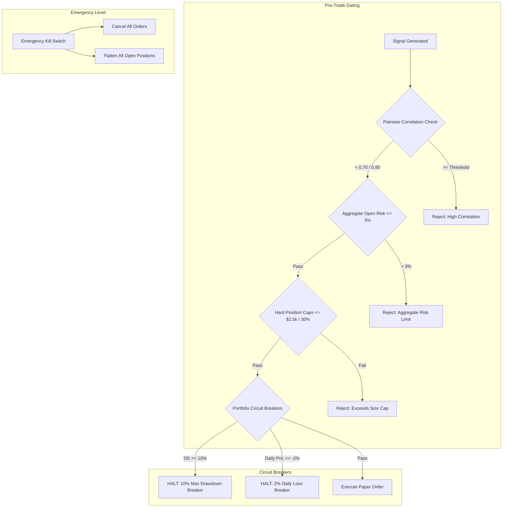

# BTC-ML SYSTEM V2 — QUANTITATIVE RISK MANAGEMENT AUDIT
**Phase 0: Risk Limits, Circuit Breakers, Denominators & Capital Preservation**  
**Date:** November 18, 2026  
**Auditors:** Financial Risk Engineer, Principal Quantitative Developer  

---

## 1. Portfolio Risk Architecture

The system enforces a multi-tiered defense-in-depth risk management framework spanning pre-trade position sizing, cross-asset correlation gating, continuous portfolio-level circuit breakers, and emergency broker kill switches.



---

## 2. Risk Controls & Invariants Audit Matrix

| Risk Constraint | Policy Specification | Implemented Code Location | Implemented Parameter Value | Compliance Status |
| :--- | :---: | :--- | :---: | :---: |
| **Per-Trade Risk** | **0.50%** | `portfolio_paper_trader.py:409` | `comp_capital * 0.005` | **Discrepancy (See RSK-001)** |
| **Max Open Portfolio Risk**| **3.00%** | `portfolio_paper_trader.py:497` | `current_open_risk / equity <= 0.03` | **Verified Fully Compliant** |
| **Daily Loss Limit** | **2.00%** | `portfolio_paper_trader.py:251` | `daily_pnl_pct <= -0.020` | **Verified Fully Compliant** |
| **Max Drawdown Limit** | **10.00%** | `portfolio_paper_trader.py:247` | `current_dd_pct >= 0.100` | **Verified Fully Compliant** |
| **Strict Correlation Limit**| **0.70** | `portfolio_paper_trader.py:81` | `corr_val <= 0.70` | **Verified Fully Compliant** |
| **Loose Stage 1 Correlation**| **0.80** | `portfolio_paper_trader.py:78` | `corr_val <= 0.80` | **Verified Fully Compliant** |
| **Hard Position Dollar Cap**| **$2,500** | `alpaca_executor.py:218` | `est_val <= 2500.0` | **Verified Fully Compliant** |
| **Hard Position Equity Cap**| **30.00%** | `alpaca_executor.py:222` | `est_val / equity <= 0.30` | **Verified Fully Compliant** |

---

## 3. Detailed Forensic Findings

### Finding RSK-001: Risk Denominator Discrepancy (Sub-Allocation vs Total Equity)
- **Severity:** HIGH
- **Exact File Path:** `BTC_ML_System/btc_ml_system/src/portfolio_paper_trader.py` (lines 403-412) and `portfolio_manager.py` (lines 321-324)
- **Function or Class:** `PortfolioPaperTrader.run_paper_tick` and `PortfolioManager.run_portfolio_backtest`
- **Existing Behavior:** The trade risk dollar amount is calculated from the component asset's **sub-allocated capital**, rather than the **total portfolio equity**:
  ```python
  # In portfolio_paper_trader.py:
  comp_capital = allocations[sym]  # e.g., 10% of total equity for AAPL
  risk_amount_usd = comp_capital * 0.005  # Risks 0.5% OF the 10% allocation!
  ```
- **Expected Behavior:** In quantitative portfolio management, a "0.5% risk per trade" rule on a portfolio either represents:
  - **Interpretation A (Standard):** 0.5% of **Total Portfolio Equity** ($10,000 equity * 0.005 = $50.00 risk per trade).
  - **Interpretation B (Hierarchical):** 0.5% of the **Sub-Strategy Allocation** ($1,000 sub-capital * 0.005 = $5.00 risk per trade).
- **Identified Gap:** Under existing implementation (Interpretation B):
  - For AAPL (10% allocation): Effective risk is `0.10 * 0.005 = 0.05%` of total equity ($5.00 on $10k).
  - For BTCUSDT (25% allocation): Effective risk is `0.25 * 0.005 = 0.125%` of total equity ($12.50 on $10k).
  - This results in a 10x smaller risk on individual stocks and a 4x smaller risk on crypto than would occur under Interpretation A.
  - Furthermore, under Interpretation B, hitting the 3.0% aggregate open portfolio risk ceiling would require 24 to 60 simultaneously active positions, which is impossible given a 7-asset portfolio!
- **Recommended Fix:** Keep existing code completely preserved in Phase 0. In Phase 1, introduce a clear config flag in `portfolio_paper_v5.yaml`:
  `risk_denominator: "portfolio_equity"` (Interpretation A) vs `"component_allocation"` (Interpretation B), allowing the user to select their desired risk model explicitly.
- **Required Test:** Unit test asserting dollar risk under both denominator configurations on a $10,000 account.

---

### Finding RSK-002: Inconsistent Daily Loss Thresholds Between Component & Portfolio Configs
- **Severity:** LOW
- **Exact File Path:** `BTC_ML_System/btc_ml_system/configs/btc_4h_v4.5.yaml` vs `configs/portfolio_paper_v5.yaml`
- **Function or Class:** Configuration key `max_daily_loss_pct`
- **Existing Behavior:**
  - Component strategy configs (e.g. `btc_4h_v4.5.yaml`, `aapl_v4.3.yaml`) specify `max_daily_loss_pct: 0.010` (1.0%).
  - Portfolio configs (`portfolio_paper_v5.yaml`, `portfolio_v5.yaml`) specify `max_daily_loss_pct: 0.020` (2.0%).
- **Expected Behavior:** When running in portfolio mode, portfolio-level risk limits override component configs cleanly and transparently.
- **Identified Gap:** Discrepancy between single-asset runner thresholds (1%) and portfolio runner thresholds (2%).
- **Recommended Fix:** Document clearly that portfolio-level risk management supersedes component-level configurations in multi-asset mode.
- **Required Test:** Verify in `test_risk.py` that portfolio runner enforces 2.0% while standalone runner enforces 1.0%.

---

### Finding RSK-003: In-Memory Loss of Daily High-Water Mark on Process Restart
- **Severity:** MEDIUM
- **Exact File Path:** `BTC_ML_System/btc_ml_system/src/portfolio_paper_trader.py`
- **Function or Class:** `PortfolioPaperTrader.__init__` (lines 96-97)
- **Existing Behavior:**
  `self.daily_start_equity = self.alpaca.get_account_equity()`
  `self.peak_portfolio_equity = self.daily_start_equity`
  Both `daily_start_equity` and `peak_portfolio_equity` are initialized from current account equity at process start.
- **Expected Behavior:** If the paper trading process restarts mid-day (e.g. following a system reboot or crash):
  - `daily_start_equity` should be retrieved from DuckDB's first snapshot of the current UTC trading day.
  - `peak_portfolio_equity` should be retrieved from DuckDB's historical maximum equity record.
- **Identified Gap:** If the system is up +3% or down -1.5% and restarts mid-day, the starting baseline resets to the current equity, resetting the daily PnL calculation to 0.0% and allowing risk limits to be inadvertently bypassed.
- **Recommended Fix:** Query `portfolio_snapshots` in DuckDB during `__init__` to restore the true day-start equity and historical peak equity.
- **Required Test:** Simulate a process restart with prior snapshot data in DuckDB and verify `daily_start_equity` matches the initial morning snapshot.
