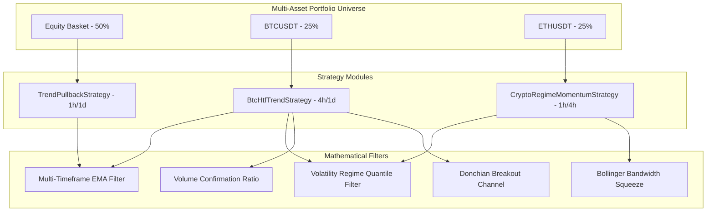

# BTC-ML SYSTEM V2 — QUANTITATIVE STRATEGY AUDIT
**Phase 0: Quantitative Strategy Logic, Regimes, Filters & Mathematical Invariants**  
**Date:** November 18, 2026  
**Auditors:** Quantitative Researcher, Principal Quantitative Developer  

---

## 1. Strategy Portfolio Architecture

The system operates three specialized quantitative strategies mapped across 7 instruments:



---

## 2. In-Depth Strategy Logic Verification

### 2.1 US Equities: Trend Pullback Strategy (Frozen V4.3)
- **Module:** `btc_ml_system/src/strategies/trend_pullback.py`
- **Applicable Symbols:** `AAPL`, `MSFT`, `NVDA`, `TSLA`, `AMZN`
- **Timeframes:** 1-Hour LTF Base / 1-Day HTF Confirmation
- **Mathematical Rules:**
  1. **Higher Timeframe Trend:** Daily Close > Daily EMA(50) and EMA(50) slope positive over 3 days (`slope > 0`). Merged backward non-repainting via `pd.merge_asof`.
  2. **Lower Timeframe Alignment:** 1H EMA(20) > 1H EMA(50).
  3. **Pullback Entry Trigger:**
     - Condition A: RSI(14) rebounding from oversold (`RSI[t-1] <= 42` and `RSI[t] > RSI[t-1]`).
     - Condition B: Price near 1H EMA(20) (`Close >= EMA20 * 0.995` and `Close <= EMA20 * 1.010`).
  4. **Exit Multiples:** Stop Loss at `1.5 * ATR(14)`, Take Profit at `3.5 * ATR(14)` (2.33x Reward-to-Risk ratio).
  5. **Trailing Stop:** Triggered at +1.5% unrealized profit, trailing at 1.2% distance below the highest high.
  6. **Frozen Invariants:** Dynamic risk sizing is disabled (`enabled: false`), profit runner is disabled (`enabled: false`), early loss cutting is disabled (`enabled: false`).

---

### 2.2 Bitcoin: 4H Higher Timeframe Trend Strategy (Locked V4.5)
- **Module:** `btc_ml_system/src/strategies/btc_htf_trend.py`
- **Applicable Symbol:** `BTCUSDT` (Alpaca: `BTC/USD`)
- **Timeframes:** 4-Hour LTF Base / 1-Day HTF Confirmation
- **Mathematical Rules:**
  1. **Multi-Timeframe Confirmation (Medium Strength):**
     - Daily Close > Daily EMA(50) AND Daily EMA(50) > Daily EMA(200).
     - Merged point-in-time via `MultiTimeframeFilter.apply_filter()`.
  2. **Trend Alignment:** 4H EMA(20) > 4H EMA(50).
  3. **Volume Confirmation:** 4H Bar Volume >= 1.15x the 24-bar volume moving average.
  4. **Breakout / Rebound Trigger:**
     - Condition A: Donchian Channel Breakout (`Close > High[t-1].rolling(20).max()`).
     - Condition B: RSI(14) Pullback Rebound (`RSI[t-1] <= 45` and `RSI[t] > RSI[t-1]`).
  5. **Volatility Regime Filtering:**
     - **Strict Mode:** Only `NORMAL` regime permitted (`allowed_regimes: ["NORMAL"]`).
     - **Loose Stage 1 Mode:** Both `NORMAL` and `CALM` regimes permitted (`allowed_regimes: ["NORMAL", "CALM"]`).
  6. **Exit Multiples & Trailing Stop:**
     - Stop Loss: `1.5 * ATR(14)`. Take Profit: `3.5 * ATR(14)`.
     - Trailing Stop: Triggered at +2.5% profit, trailing at 2.0% distance below highest high.
  7. **Preserved Invariants:** Session filter disabled (`enabled: false`), dynamic risk sizer disabled (`enabled: false`).

---

### 2.3 Ethereum: 1H Regime Momentum Strategy (Clean V4.5)
- **Module:** `btc_ml_system/src/strategies/crypto_regime_momentum.py`
- **Applicable Symbol:** `ETHUSDT` (Alpaca: `ETH/USD`)
- **Timeframes:** 1-Hour LTF Base / 4-Hour HTF
- **Mathematical Rules:**
  1. **Clean Version Invariant:** Unencumbered by Multi-Timeframe filter (`mtf_filter.enabled: false`) and Session filter (`session_filter.enabled: false`).
  2. **Volatility Regime Filter:** Strictly restricted to `CALM` regime (`volatility <= 33rd percentile`). Blocks choppy/high regimes.
  3. **Bollinger Band Squeeze:** Bandwidth `(Upper BB - Lower BB) / SMA(20) <= 0.05` on previous bar, or `<= 0.06` on current bar.
  4. **Momentum Expansion:** Close > Upper BB(20, 2.0) AND RSI(14) >= 52.0.
  5. **Exit Multiples:** Stop Loss at `1.5 * ATR(14)`, Take Profit at `3.5 * ATR(14)`. Trailing stop is explicitly disabled (`enable_trailing_stop: false`) to avoid premature shakeouts in clean momentum moves.

---

## 3. Mathematical Verification of Technical Indicators

The indicator implementations were audited against established financial mathematical definitions:

1. **RSI (Wilder's Exponential Smoothing):**
   - Implemented as: `gain.ewm(alpha=1/period, adjust=False).mean()`.
   - *Status:* Verified. Correctly matches J. Welles Wilder's modified moving average formulation.
2. **True Range (TR) & Average True Range (ATR):**
   - Implemented as: `max(high - low, abs(high - close[t-1]), abs(low - close[t-1]))` smoothed via `ewm(alpha=1/period, adjust=False)`.
   - *Status:* Verified. Correctly captures price gaps between bars.
3. **Donchian Breakout High:**
   - Implemented as: `high.shift(1).rolling(20).max()`.
   - *Status:* Verified non-repainting. Shifting by 1 prevents the current bar's high from leaking into the threshold.
4. **HTF Merger Alignment:**
   - Implemented via: `pd.merge_asof(..., direction="backward", on="close_time")`.
   - *Status:* Verified lookahead-free. Matches the most recently completed HTF bar at or before the LTF bar's close.

---

## 4. Strategy Audit Findings

### Finding STR-001: Standalone Config Discrepancy for ETH Session Filter
- **Severity:** MEDIUM
- **Exact File Path:** `BTC_ML_System/btc_ml_system/configs/eth_1h_v4.5.yaml`
- **Function or Class:** Configuration key `session_filter`
- **Existing Behavior:** In `eth_1h_v4.5.yaml`, lines 39-42 specify:
  ```yaml
  session_filter:
    enabled: true
    start_hour: 14
    end_hour: 22
  ```
  However, in `portfolio_paper_trader.py` line 207, the code forcibly overrides this:
  `asset_cfgs["ETHUSDT"]["session_filter"] = {"enabled": False}` to respect the user's locked requirement of "ETH Clean version (No session filter)".
- **Expected Behavior:** Configuration files should accurately reflect the active strategy rules so standalone scripts (`run_pipeline_v4.5.py`) and portfolio runners produce identical signals.
- **Identified Gap:** Running a standalone backtest with `eth_1h_v4.5.yaml` filters out trades outside 14:00-22:00 UTC, while portfolio paper trading allows 24/7 entries.
- **Recommended Fix:** Update `eth_1h_v4.5.yaml` to set `session_filter: enabled: false`, synchronizing config files with code overrides.
- **Required Test:** Verify that running `crypto_regime_momentum.py` with `eth_1h_v4.5.yaml` generates signals across all 24 hours of the day.

---

### Finding STR-002: Annualization Factor Assumption in Volatility Regime Classifier
- **Severity:** LOW
- **Exact File Path:** `BTC_ML_System/btc_ml_system/src/regimes.py`
- **Function or Class:** `VolatilityRegimeClassifier.predict_regimes` (lines 38-42)
- **Existing Behavior:** Annualized volatility is computed as:
  `vol = df["close"].pct_change().rolling(self.window).std() * np.sqrt(24 * 365)`
  This factor assumes 1-hour candles on a 24/7 continuous market.
- **Expected Behavior:** Annualization should account for timeframe and asset type:
  - 1H Crypto: `np.sqrt(24 * 365) = np.sqrt(8760)`
  - 4H Crypto: `np.sqrt(6 * 365) = np.sqrt(2190)`
  - 1H Stock: `np.sqrt(6.5 * 252) = np.sqrt(1638)`
  - Daily Stock: `np.sqrt(252)`
- **Identified Gap:** The raw volatility value for BTC (4H) and Stocks (1H) is over-scaled. Because quantiles (`expanding(50).quantile(0.33)`) are scale-invariant across the same series, regime classifications are functionally preserved, but logged numeric volatility values are inflated.
- **Recommended Fix:** Pass `interval` and `asset_type` to calculate the exact frequency-based annualization scalar.
- **Required Test:** Compare quantile assignments before and after scaling to ensure zero regime classification divergence.
