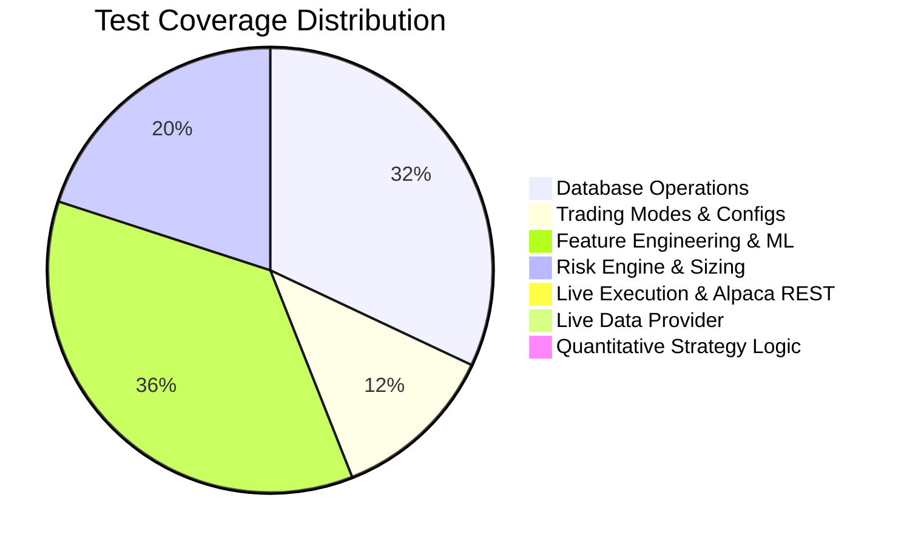

# BTC-ML SYSTEM V2 — TEST COVERAGE REPORT
**Phase 0: Test Execution Audit, Coverage Analysis & Mock Infrastructure Gaps**  
**Date:** November 18, 2026  
**Auditors:** Site Reliability Engineer, Senior Algorithmic Trading Engineer  

---

## 1. Test Suite Execution Summary

The test suites across both packages were executed in the local Windows Python 3.12 environment:

### 1.1 `btc_ml_system/tests` (Production Package)
- **Status:** **16 PASSED, 0 FAILED** (Duration: 16.52 seconds)
- **Test Inventory:**
  - `test_database.py::test_schema_initialization` — PASSED
  - `test_database.py::test_trade_insertion_and_query` — PASSED
  - `test_database.py::test_equity_curve_insertion` — PASSED
  - `test_database.py::test_positions_upsert_and_clear` — PASSED
  - `test_database.py::test_portfolio_snapshot_insertion` — PASSED
  - `test_database.py::test_export_to_csv` — PASSED
  - `test_database.py::test_trade_journal_duckdb_integration` — PASSED
  - `test_database.py::test_auto_analyzer_with_duckdb` — PASSED
  - `test_features.py::test_feature_generation` — PASSED
  - `test_labels.py::test_triple_barrier_labeler` — PASSED
  - `test_leakage.py::test_purged_splits` — PASSED
  - `test_pipeline.py::test_pipeline_integration` — PASSED
  - `test_risk.py::test_risk_engine` — PASSED
  - `test_trading_modes.py::test_strict_mode_configuration` — PASSED
  - `test_trading_modes.py::test_loose_stage1_mode_configuration` — PASSED
  - `test_trading_modes.py::test_config_fallback_and_switch` — PASSED

### 1.2 `crypto_ml_trader/tests` (Legacy Research Package)
- **Status:** **12 PASSED, 0 FAILED** (Duration: 2.12 seconds)
- **Test Inventory:**
  - `test_features.py` (3 tests): 1H feature creation, 4H point-in-time shift non-leakage, target leakage detection — ALL PASSED
  - `test_labels.py` (3 tests): Triple barrier buy label, sell label, vertical expiry — ALL PASSED
  - `test_leakage.py` (2 tests): Purged walk-forward splits, feature matrix future timestamp check — ALL PASSED
  - `test_risk.py` (4 tests): Position sizing math, daily loss lock, max drawdown shutdown, decision engine rejections — ALL PASSED

---

## 2. Test Coverage & Gap Analysis

---

## 3. Testing Audit Findings

### Finding TST-001: Absence of Mock Broker Integration Tests for `AlpacaExecutor`
- **Severity:** HIGH
- **Exact File Path:** `BTC_ML_System/btc_ml_system/src/alpaca_executor.py`
- **Function or Class:** `AlpacaExecutor`
- **Existing Behavior:** No unit or integration tests exist for `AlpacaExecutor`. All execution code is currently verified only during manual paper-trading runs against the live Alpaca API.
- **Expected Behavior:** An institutional testing harness must include unit tests with mocked HTTP responses (`responses` or `unittest.mock`) covering:
  - Account detail parsing and error handling.
  - Position fetching and symbol sanitization.
  - Order placement with various order types (fractional equities, crypto with slashes).
  - Idempotency and duplicate order rejection.
  - Hard risk cap enforcement ($2,500 position value, 30% equity).
  - Emergency kill switch (order cancellation and position flattening).
- **Identified Gap:** Regressions in order submission payload formatting (such as `client_order_id` or `time_in_force`) can slip undetected into production.
- **Recommended Fix:** Implement `tests/test_alpaca_executor.py` utilizing `requests_mock` to validate all API contracts without network access.
- **Required Test:** Add 8 test cases verifying order payload shapes, headers, status handling, and safety caps.

---

### Finding TST-002: Missing Unit Tests for Specialized Strategy Classes
- **Severity:** MEDIUM
- **Exact File Path:** `BTC_ML_System/btc_ml_system/src/strategies/`
- **Function or Class:** `BtcHtfTrendStrategy`, `CryptoRegimeMomentumStrategy`, `TrendPullbackStrategy`
- **Existing Behavior:** No dedicated unit tests exist for the individual strategy modules in `src/strategies/`. Strategy logic is only tested indirectly through pipeline integration tests.
- **Expected Behavior:** Each strategy class should have a dedicated test file validating its entry and exit rules on synthetic, deterministic OHLCV candles (e.g. testing Donchian breakout trigger, oversold RSI rebound, Bollinger Band squeeze condition).
- **Identified Gap:** Any accidental modification to strategy parameters, indicator periods, or threshold logic cannot be caught automatically by CI.
- **Recommended Fix:** Create `tests/test_strategies.py` with parameterized test cases for each of the 3 active strategies.
- **Required Test:** Synthetic bar test verifying that `BtcHtfTrendStrategy` triggers a BUY signal if and only if Donchian breakout, EMA alignment, and volume confirmation are simultaneously satisfied.

---

### Finding TST-003: NumPy Timedelta Generic Unit Deprecation Warnings
- **Severity:** LOW
- **Exact File Path:** `BTC_ML_System/btc_ml_system/tests/test_features.py`, `test_labels.py`, `test_pipeline.py`
- **Function or Class:** Test candle timestamp generation
- **Existing Behavior:** Tests use bare integer arithmetic with NumPy timedeltas, generating warnings:
  `DeprecationWarning: The 'generic' unit for NumPy timedelta is deprecated, and will raise an error in the future. This includes implicit conversion of bare integers (e.g. + 1). Please use a specific unit instead.`
- **Expected Behavior:** Timedelta arithmetic should explicitly declare time units (e.g. `pd.Timedelta(hours=1)`).
- **Identified Gap:** Tests will fail on future NumPy / Pandas major version upgrades.
- **Recommended Fix:** Update test fixture candle generators to use explicit timedeltas.
- **Required Test:** Re-run pytest and verify the elimination of all 10 deprecation warnings.
