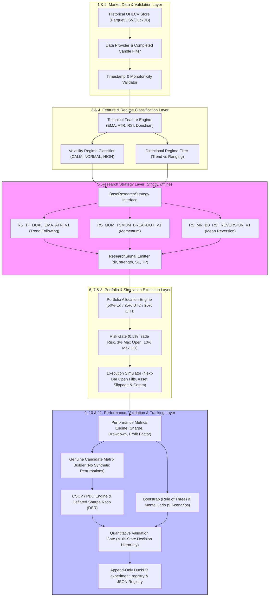

# PHASE 3A — QUANTITATIVE RESEARCH ARCHITECTURE SPECIFICATION

**Architecture Version:** 3.0.0  
**Phase:** Phase 3A (Strategy Architecture & Quantitative Research Foundation)  
**Author:** Principal Quantitative Developer & Risk Architect  
**Status:** `RESEARCH ONLY — STRICTLY OFFLINE`

---

## 1. Architectural Mission & Separation of Concerns

The objective of Phase 3A is to establish an institutional-grade, modular quantitative research platform that decouples strategy hypothesis formulation from execution mechanics, broker APIs, and paper-trading state machines.

The architecture strictly separates 11 discrete quantitative pipeline stages:
1. **Market Data Ingestion:** Acquires chronological OHLCV candle streams across multi-asset universes.
2. **Data Validation & Normalization:** Validates UTC monotonic ordering, enforces closed candles, and rejects gaps.
3. **Feature & Indicator Calculation:** Computes mathematical indicators strictly on historical bar slices without lookahead.
4. **Market Regime Classification:** Dynamically classifies market environment into volatility and directional regimes.
5. **Strategy Signal Generation:** Emits atomic research signals (direction, strength, stop loss, take profit).
6. **Portfolio Construction:** Allocates capital across active assets according to correlation, volatility, and sector limits.
7. **Risk Management:** Enforces hard portfolio circuit breakers (0.5% risk/trade, 3% aggregate, 2% daily loss, 10% max DD).
8. **Execution Simulation:** Simulates next-bar open fills with asset-specific slippage (5 bps crypto, 2 bps equities) and commissions.
9. **Performance Measurement:** Computes unannualized and annualized Sharpe, Sortino, Calmar, max drawdown, and profit factor.
10. **Statistical Validation:** Evaluates CSCV/PBO, Deflated Sharpe Ratio (DSR), Block Bootstrap, and Monte Carlo stress suites.
11. **Persistent Experiment Tracking:** Records full configuration, Git SHA, metrics, and trial metadata to DuckDB (`experiment_registry`).

---

## 2. Quantitative System Architecture Diagram

---

## 3. Data Flow Specification

1. **Chronological Ingestion:**
   Market data is loaded as immutable pandas DataFrames. Every record must possess a timezone-aware UTC `open_time`, complete OHLCV values, and strict monotonic ordering. Unclosed live candles are strictly rejected at ingestion.
2. **Feature Isolation:**
   Strategies declare their required features via `required_features()`. Features are computed sequentially; calculations at bar $t$ use only bars $\le t$.
3. **Signal Generation:**
   `generate_signals()` evaluates entry and exit triggers strictly on bar close, emitting direction $\in \{-1, 0, 1\}$ and calculating explicit price levels for stop-loss and take-profit targets.
4. **Execution Protocol:**
   `ResearchSimulationRunner` receives signals generated at bar close $t$ and schedules execution for bar $t+1$ at `open`.
   Fills incur:
   - US Equities: 2 bps slippage on entry, 2 bps slippage on exit, 0 bps commission.
   - Crypto: 5 bps slippage on entry, 5 bps slippage on exit, 10 bps commission at exit.
5. **Validation & Tracking:**
   Periodic return vectors are verified via `ReturnUnit.PERCENTAGE_POINTS`. Genuine return streams feed the candidate matrix builder for PBO. Every run is permanently committed to DuckDB `experiment_registry`.

---

## 4. Safety & Governance Rules

- **Zero Live/Broker Coupling:** No research strategy possesses methods, imports, or tokens capable of connecting to Alpaca, Binance, or any external execution endpoint.
- **Frozen Baseline Integrity:** Production strategy configurations in `configs/` (`aapl_v4.3.yaml`, `btc_4h_v4.5.yaml`, `portfolio_paper_v5.yaml`) remain untouched.
- **Rejection Invariance:** The baseline system remains **REJECTED — NOT ELIGIBLE FOR PAPER TRADING**. Research strategies must prove statistical edge under institutional hurdles before any deployment can be considered.
